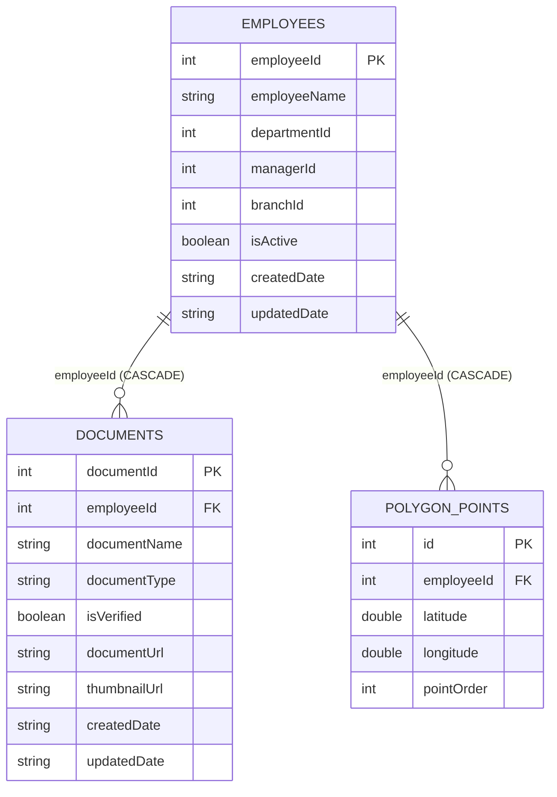

# Employee Hub - Android Application

> **Employee Details API Integration with Room DB CRUD Operations & Interactive Employee Map Area Polygon**

A modern, offline-first Android application built with Kotlin, Jetpack Architecture Components (MVVM + Repository Pattern), Room Persistence Library, Retrofit with Gson, Glide for image caching, and OsmDroid for interactive geospatial polygon drawing.

---

## 📱 Features Overview

### 1. Offline-First Architecture & Remote API Sync
* **Single Source of Truth**: Room Database serves as the local database cache. All UI data flows reactively from Room via Kotlin Coroutines `Flow` and `StateFlow`.
* **Remote Sync**: Seamless integration with the GET endpoint (`https://mocki.io/v1/08f6af34-d99f-4ab2-bd09-6c9e953829d4`).
* **Offline Resilience**: When offline or if network requests fail, the app immediately serves previously cached employees, documents, and polygon areas from Room with an offline status banner.
* **Pull-to-Refresh**: `SwipeRefreshLayout` support allows on-demand synchronisation.

### 2. Rich & Modern User Interface (Material 3)
* **Metrics Dashboard**:
  * **Total Employees** count
  * **Active Employees** count
  * **Geofenced/Mapped Employees** count
* **Live Dynamic Search**: Real-time multi-attribute search filtering by:
  * Employee Name
  * Employee ID
  * Department ID
* **Interactive Filter Chips**:
  * `All`
  * `Active` (Emerald status chip)
  * `Inactive` (Slate status chip)
  * `Geofenced Only` (Filters employees who have saved map polygons)
* **Sorting Capabilities**:
  * Name (A–Z)
  * Name (Z–A)
  * ID (Low–High)
  * ID (High–Low)
* **Employee List Cards**:
  * Avatar with name initials
  * Employee Name & ID badges
  * Department (`Dept #`), Manager (`Mgr #`), and Branch (`Branch #`) badges
  * Employment status pill (`Active` / `Inactive`)
  * Document count and nested horizontal thumbnail carousel
  * Quick action buttons: **Map Area**, **Edit**, **Delete**

### 3. Document Management & Image Loading
* **Horizontal Document Carousel**: Displays each employee's associated documents with thumbnails.
* **Glide Image Loading**: Efficient image loading, caching, disk caching, and error handling.
* **Document Badges**: Visual indicator for document type (`JPG`, `PNG`, `PDF`) and green verified badge (`✓ Verified`).
* **Document Creation**: Add custom documents with Name, Type, and URLs during Add/Edit flow.

### 4. Interactive Map Polygon Drawing & Geofencing
* **Interactive OsmDroid Integration**: OpenStreetMap powered, completely free with zero billing requirements or mandatory API keys.
* **Polygon Drawing**: Tap anywhere on the map to place polygon vertices.
* **Vertex Management**:
  * Numbered marker pin placed at each vertex.
  * Tap existing marker to remove that vertex with confirmation.
  * **Undo** button to remove the most recently placed point.
  * **Clear** button to wipe the polygon.
  * **Save Area** button: persists vertices into Room DB.
* **Geospatial Metrics (Live HUD)**:
  * Active vertex count (`Vertices: N`).
  * Real-time geodesic **Area calculation** (in $m^2$ or $km^2$ using spherical earth projection).
  * Real-time geodesic **Perimeter calculation** (using Haversine formula).
* **Automatic Reloading**: Reopening the map for an employee automatically loads their saved polygon, redraws the stroke and fill, and centers the camera on the polygon.

### 5. Full CRUD Operations with Cascading Deletion
* **Create**: Add new employees with name, department, manager, branch, active status, and documents.
* **Update**: Edit any existing employee and their associated documents.
* **Delete with Cascading Deletion**:
  * Deleting an employee prompts a confirmation dialog.
  * SQLite `FOREIGN KEY (employeeId) REFERENCES employees(employeeId) ON DELETE CASCADE` automatically cleans up all child `documents` and `polygon_points`.
  * **Undo Action**: Material Snackbar allows instant restoration of deleted employees.

---

## 🏗️ Architecture & Technology Stack

```
com.example.employeemanager
├── EmployeeApplication.kt          # Global Application class (OsmDroid init)
├── data
│   ├── db
│   │   ├── AppDatabase.kt          # Room Database definition
│   │   └── EmployeeDao.kt          # Room DAO with Transactions & Cascades
│   ├── model
│   │   ├── Employee.kt             # Employee Room Entity
│   │   ├── Document.kt             # Document Room Entity (CASCADE foreign key)
│   │   ├── PolygonPoint.kt         # Map Polygon Vertex Room Entity (CASCADE foreign key)
│   │   └── EmployeeWithDocuments.kt# Room 1-to-many relationship & API wrappers
│   ├── network
│   │   ├── EmployeeApiService.kt   # Retrofit GET API definition
│   │   └── RetrofitClient.kt       # OkHttp + Retrofit + Gson client
│   └── repository
│       └── EmployeeRepository.kt   # Single source of truth repository
└── ui
    ├── addedit
    │   └── AddEditEmployeeActivity.kt # Employee & document creation/editing
    ├── list
    │   ├── DocumentPreviewAdapter.kt  # Horizontal document preview adapter
    │   ├── EmployeeListAdapter.kt     # Main employee card adapter
    │   ├── EmployeeListActivity.kt    # Main dashboard screen
    │   └── EmployeeListViewModel.kt   # StateFlow & Coroutines ViewModel
    └── map
        └── MapPolygonActivity.kt      # Interactive polygon drawing & persistence
```

### Libraries Used:
* **Kotlin Coroutines & Flow**: Asynchronous programming and reactive data streams.
* **Jetpack Room (2.6.1)**: Local SQLite object mapping and relational queries.
* **Jetpack Lifecycle & ViewModel (2.8.7)**: Lifecycle-aware state preservation.
* **Retrofit (2.11.0) & Gson**: REST API communication and JSON serialization.
* **OkHttp Logging Interceptor (4.12.0)**: Network debugging and logging.
* **Glide (4.16.0)**: Image loading and memory caching.
* **OsmDroid (6.1.18)**: OpenStreetMap SDK for Android.
* **Google Play Services Maps (19.0.0)**: Google Maps SDK configured in Manifest.
* **Material Components (1.12.0)**: Material Design 3 cards, text fields, chips, buttons, and dialogs.

---

## 🗄️ Database Schema & Relationships



---

## 🚀 How to Run the Project

### Prerequisites:
* Android Studio (Ladybug / Koala / Hedgehog or newer)
* Android SDK (API Level 24 to 35)
* JDK 17 or JDK 18 (or Android Studio bundled JBR)

### Steps:
1. Open **Android Studio**.
2. Select **Open** and choose the directory:
   ```
   C:\Users\Prashant\Desktop\EmployeeManagementApp
   ```
3. Allow Gradle to sync.
4. Run the project on an Android Emulator or connected Physical Device by clicking the green **Run (Shift + F10)** button.

### Pre-built APK:
A ready-to-install debug APK is located at:
```
C:\Users\Prashant\Desktop\EmployeeManagementApp\app\build\outputs\apk\debug\app-debug.apk
```

---

## 🧪 Unit Tests

Unit tests are included to verify filtering, sorting, and geospatial calculations:
* `EmployeeFilterSortTest`: Verifies real-time search queries, active/inactive filters, and multi-attribute sorting.
* `PolygonMathTest`: Verifies geodesic polygon area and Haversine perimeter calculations.

To execute unit tests:
```shell
gradlew testDebugUnitTest
```
All tests pass cleanly (`BUILD SUCCESSFUL`).
